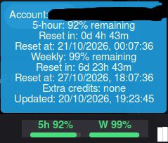
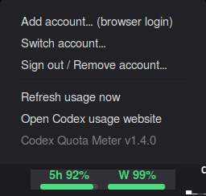

# Codex Quota Meter

**Version:** 1.5.0  
**Author:** [Icators](https://github.com/Icators)  
**Desktop:** Cinnamon (developed for Linux Mint 22.3)  
**Requirement:** The official **OpenAI Codex CLI** must be installed separately. This applet does **not** install Codex for you.

### Screenshots (actual Cinnamon applet)

**Hover: quota percentages, reset countdowns and timestamps**



**Left-click: account management menu**



*These screenshots were captured from an earlier v1.4.x installation; the applet package remains v1.5.0.*

A compact panel applet showing remaining Codex usage in the **5-hour** and **weekly** windows, with two color-coded progress meters. Hover to see reset countdowns, reset timestamps and extra credit details *when the CLI exposes them*. Left-click for email-based account management and refresh.

## Prerequisites

- Cinnamon desktop, Python 3 and a terminal emulator (`x-terminal-emulator`).
- Official `codex` command installed and available in your Cinnamon session's `PATH`.
- A ChatGPT/OpenAI account eligible for Codex, signed in via the official CLI browser flow.
- Internet connection for quota refresh.

### 1. Check whether Node.js and npm are installed

Open a terminal and run:

```bash
node -v
npm -v
```

If either is missing, on Linux Mint you can start with:

```bash
sudo apt update
sudo apt install nodejs npm
```

**Important:** Distribution packages can provide an older Node.js version. If the npm installation reports an unsupported Node.js version, upgrade Node.js using the official [Node.js installation guidance](https://nodejs.org/en/download) (for example, an up-to-date LTS release). Do not assume that `apt install` provides a sufficiently recent version.

### 2. Install the official Codex CLI

With a compatible Node.js and npm installation:

```bash
npm install -g @openai/codex
```

If you prefer to avoid Node.js entirely, see the [official Codex repository](https://github.com/openai/codex) for its supported standalone installer and downloadable Linux binaries. The applet itself needs `codex`, not npm.

Check that installation worked:

```bash
codex --version
command -v codex
```

If `codex` is not found, reopen your terminal and check the npm global binary directory and `PATH`. The command must also be visible to the Cinnamon desktop process.

### 3. Authenticate

You may verify CLI authentication with:

```bash
codex login
```

Complete the official browser sign-in. The applet's **Add account** action starts a separate CLI browser login in an isolated `CODEX_HOME` so it can monitor multiple email accounts without switching your main editor's session.

## Install the applet manually

Copy `files/codex-meter@Icators/` into:

```text
~/.local/share/cinnamon/applets/codex-meter@Icators/
```

Open **System Settings → Applets**, select **Codex Quota Meter**, and add it to your panel. Left-click the applet → **Add account** → finish browser login.


## Features

- Two compact, colored percentage meters (5-hour and weekly).
- **Green:** above 30%; **orange:** above 10% through 30%; **red:** 10% or less.
- Hover details include quota resets and remaining time, when returned by the CLI.
- Add account with browser sign-in; switch by email; sign out/remove an account.
- Refresh periodically and manually.

### Important limitations

- The applet reads quota information using Codex CLI's app-server interface, which may change between CLI releases.
- Some accounts do not expose all rate limits or extra-credit fields. Missing information is not treated as zero.
- **Manual usage reset vouchers** (how many are available and when each expires) are **not currently retrieved**. They are distinct from ordinary 5-hour/weekly quota reset timestamps.
- Switching the account monitored by the applet does not automatically switch your IDE or browser accounts.
- The applet does not require your ChatGPT password and should not be given browser cookies.

## Cinnamon Spices submission note

This applet relies on an externally installed executable (`codex`). The Cinnamon Spices maintainers may decline this submission under their self-contained-spice rules. This README documents the dependency transparently; it does not imply prior approval.

## Development and testing

Add this directory to a fork of [linuxmint/cinnamon-spices-applets](https://github.com/linuxmint/cinnamon-spices-applets) and from the repository root run:

```bash
./validate-spice codex-meter@Icators
./test-spice codex-meter@Icators
```

The applet has been checked for basic syntax, but **live Cinnamon testing and upstream validation are still required**.

## License

MIT License (see `LICENSE`). The applet is an independent community project and is not affiliated with or endorsed by OpenAI or Linux Mint.
