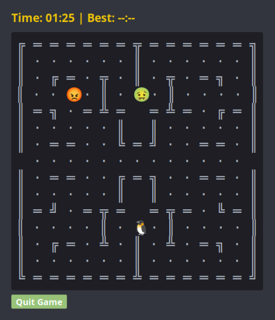

# GTA Mint Classic Games

An applet with 7 classic games to make you look busy at the office...

## Features

- **Pac Man**: A take on the classic game of Pac Mane
- **Jungle Run**: Run throught the Jungle avoiding the trees
- **IQ Test**: Answer 10 skill testing question 
- **Obstacle Course**: Allows you to change how fast the lights blink
- **Chinese GO**: Allows you to change the background transparency
- **Sudoku**: Classic Sudoku, but with a 'Solve' button.
- **Tetris**: Test your eye-hand coordination.

## Requirements

This applet relies on standard system libraries, but ensure you have `glib` and `gtop` bindings available (installed by default on most Linux Mint installations).

## Settings

Right-click the applet on your desktop and select **Configure** to access:
- Change Size
- Change Emjoi
- Change Game
- Change Difficulty
- and much more...

## Credits

- Created by [NicNielsen](https://github.com)
- Inspired by the Linux Mint Open-Source community
