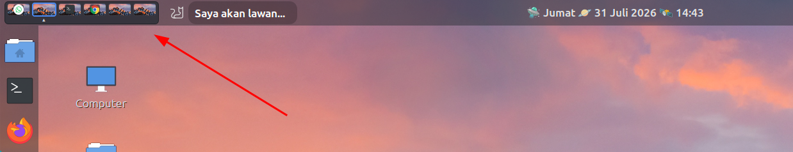

# Overview Workspace Switcher for Cinnamon (`ow-workspace-switcher`)

A sleek, highly customizable workspace switcher applet for the Cinnamon desktop environment. Instead of simple blocks or numbers, this applet features an **Overview Mode** that displays a miniature version of your desktop wallpaper along with the top-most application icon for each workspace.

## Screenshot

## ✨ Features

* **🖼️ Overview Mode:** Displays your current desktop wallpaper inside the workspace boxes.
* **📱 App Icons:** Automatically detects and displays the icon of the currently focused/top-most window in each workspace.
* **🎨 Theme Support:** Includes built-in **Dark** and **Light** themes to match your Cinnamon panel style.
* **📍 Active Indicators:** Clearly see which workspace you are on. You can choose to hide the indicator or select from three styles:
  * Triangle (▲)
  * Circle Filled (●)
  * Circle Empty (○)
* **📏 Custom Sizing:** Panel too big or too small? You can easily override the default sizes and set a custom width and height for the workspace boxes directly from the settings.
* **🖼️ Per-Workspace Wallpapers:** Set custom background images for each workspace (up to 10 workspaces) that automatically change when you switch workspaces.
* **🎚️ Custom Transparency:** Toggle and adjust the opacity slider for the main applet container to seamlessly blend with your panel.

## Requirements

* Cinnamon 4.0 or higher (Cinnamon 6.0+ recommended)

## Installation

1. Right-click on the Cinnamon panel where you wish to add the applet and click **Applets**.
2. Click on the **Download** tab, search for **OW Workspace Switcher**, and click the install button on the right.
3. Go back to the **Manage** tab, select **OW Workspace Switcher**, and click the `+` button at the bottom to add it to your panel.
4. Right-click on the applet in your panel and select **Configure...** to customize settings to your liking.

## ⚙️ Configuration Options

* **Theme:** Choose between Dark and Light mode.
* **Overview Window:** Toggle the wallpaper and app icon preview on or off (if disabled, displays workspace numbers).
* **Show Active Workspace Indicator:** Toggle the bottom indicator on or off.
* **Indicator Shape:** Choose the style of the active workspace indicator (Triangle, Circle Filled, Circle Empty).
* **Manual set workspace box size:** Enable to unlock custom height and width dimensions.
* **Enable custom transparency:** Toggle and adjust opacity percentage.
* **Enable Custom Wallpaper per Workspace:** Set unique background wallpapers for up to 10 workspaces.

## 🤝 Contributing

Contributions, issues, and feature requests are welcome! Feel free to check the GitHub repository or submit pull requests.

## 📝 License

This project is open-source and available under the MIT License.

---
*Created for the Cinnamon Desktop Environment.*
