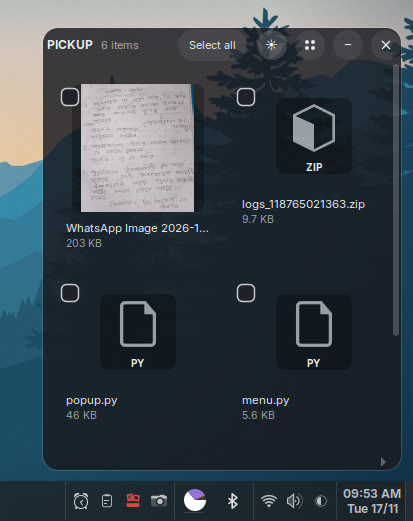
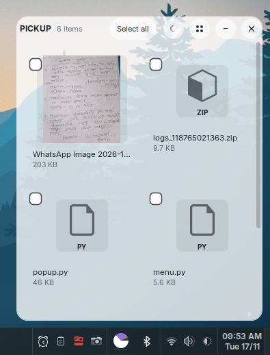
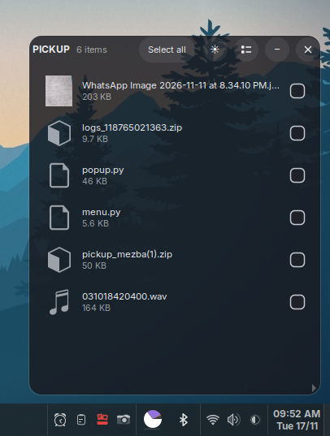
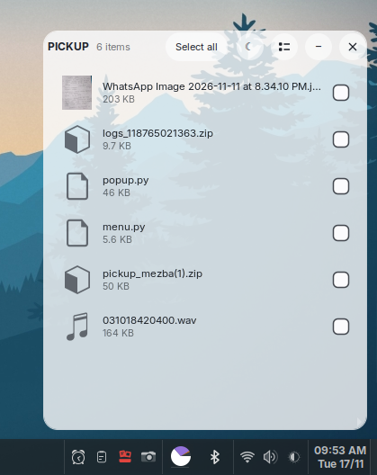

# Pickup

A small panel applet that gives you a temporary shelf for drag and drop.
Drag files, folders or selected text onto it, carry on with what you were
doing, then drag them back out into any other application when you are ready.

## Screenshots

|  | Dark | Light |
|---|---|---|
| **Grid** |  |  |
| **List** |  |  |

## Features

- **One click to open and close.** Click the panel icon to open the shelf and
  click it again to close it. The icon turns red while the shelf holds
  something.
- **Drag in** files, folders or selected text from any application.
- **Drag out** one item, or several (select them with the checkboxes), into
  any other application.
- **Files are referenced, not copied**, so the shelf uses no extra disk space.
  Text snippets are stored as small files.
- **Grid or list view**, switched with one click. Images and videos get
  thumbnails; everything else gets an icon matching its type.
- **Right-click** an item to copy it, open its folder, pin it or clear it.
  With several items selected, *Clear* removes all of them.
- **Pin** the items you want to keep. Unpinned items are removed after
  48 hours.
- **Minimize to the screen edge.** The minimize button folds the shelf into a
  small tab on the nearest side of the screen. Click the tab to bring the shelf
  back, or hover a drag over it and the shelf opens so you can drop straight
  in, then folds away again.
- **Dark and light appearance**, switched from the shelf header.
- Remembers its size and position.
- Lightweight: the shelf window only runs while it is open or minimized, and
  closing it frees all of its memory.

## Usage

1. Click the Pickup icon in the panel.
2. Drag a file, folder or some selected text onto the shelf.
3. Drag it back out wherever you need it, or right-click it for more options.
4. Click the panel icon again (or the close button) when you are done.

## Requirements

- Cinnamon 5.8 or newer
- Python 3 with the GTK 3 bindings (`python3-gi`, `gir1.2-gtk-3.0`)
- Optional: `ffmpegthumbnailer` or `ffmpeg` for video thumbnails

## Notes

- Pickup positions its own window, so it is designed for X11 sessions. Window
  placement and the edge tab may not behave as intended on Wayland.
- Settings and the item list are kept in `~/.config/pickup/`. Text you put on
  the shelf is stored there as plain, unencrypted files, so avoid leaving
  passwords or other secrets on it.
- Errors are logged to `~/.config/pickup/pickup.log`.
