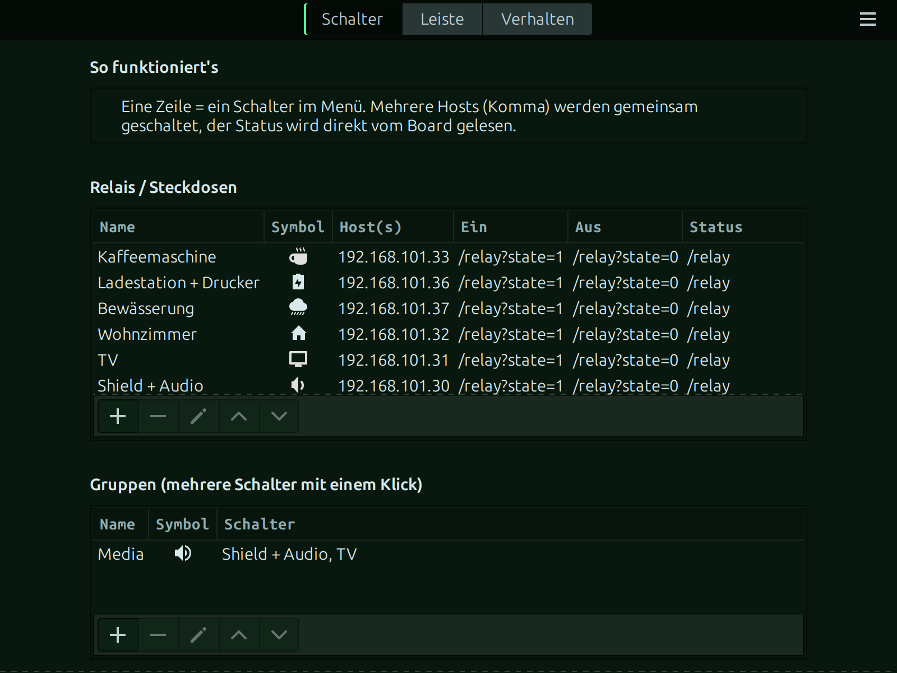

# Relay Switches — Cinnamon applet

[Deutsch](README.de.md)

Panel applet for HTTP relay boards (smart sockets, coffee machine, printer, …).
One click opens a menu that switches the configured relays and reads the real
state back from the board.


## Features

- Any number of switches, each with its own name, icon, hosts and paths.
- Several hosts per switch are switched together, e.g. one power strip on two boards.
- Groups combine several switches into one additional switch.
- Real status: the applet reads the status path instead of assuming the state.
- Panel icon, optional counter (`2/4`) or the names of the active switches.
- Periodic status polling, optional notification when a device does not answer.
- `relayctl` CLI for scripts, hotkeys and cron; it reads the exported
  configuration and runs without Cinnamon.
- English and German user interface.

## Languages

The interface is available in English and German. English is the source
language, German comes from `po/de.po`; the language follows the desktop locale,
there is no switch inside the applet.

To add a language, copy `po/de.po` to `po/<language>.po`, translate the
`msgstr` values and run the `msgfmt` loop from the installation again
(`xgettext`/`msgmerge` regenerate the string list after changes).

## Installation

In Cinnamon: **System Settings → Applets → Download** → *Relay Switches*, then
add it from the **Manage** tab.

From source (the applet files are in the root of this repository):

```bash
git clone https://github.com/ravelzh/ravel-cyber-pulse-cinnamon-relay-switches.git
cd ravel-cyber-pulse-cinnamon-relay-switches

# applet files
install -d ~/.local/share/cinnamon/applets/relay-switches@ravel
install -m 644 metadata.json applet.js settings-schema.json icon.png \
        ~/.local/share/cinnamon/applets/relay-switches@ravel/

# translations (needs gettext)
for po in po/*.po; do
    lang="$(basename "$po" .po)"
    install -d "$HOME/.local/share/locale/$lang/LC_MESSAGES"
    msgfmt -o "$HOME/.local/share/locale/$lang/LC_MESSAGES/relay-switches@ravel.mo" "$po"
done

# optional: CLI
install -Dm 755 relayctl ~/.local/bin/relayctl
```

Reload Cinnamon (or log in again):

```bash
dbus-send --session --dest org.Cinnamon --object-path /org/Cinnamon \
  --type=method_call org.Cinnamon.Eval string:'global.reexec_self()'
```

Then add the applet: right-click the panel → **Applets** → **Relay Switches**.

## Configuration

Right-click the applet → **Configure**. The switch list is empty after a fresh
installation, so add your switches there.

| Page | Options |
| --- | --- |
| Switches | Name, icon, host(s), on/off/status path per switch; groups |
| Panel | Text next to the icon, panel icon, icon while something is on, middle click action |
| Behavior | Polling interval, notifications, "All on"/"All off" entries, HTTP timeout |

A switch needs a name and at least one host. The paths are pre-filled with
`/relay?state=1`, `/relay?state=0` and `/relay`, so for typical relay boards
only the host has to be entered:

| Name | Icon | Host(s) | On | Off | Status |
| --- | --- | --- | --- | --- | --- |
| Coffee | coffee-symbolic | 192.168.1.50 | /relay?state=1 | /relay?state=0 | /relay |

Hosts are separated by commas and may be IP addresses or URLs
(`http://board.local:8080`). Groups are rows on the same page and refer to
switch names, e.g. *Media* = `TV, Amplifier`.



## Status format

The response of the status path may be JSON (`{"on": true}`), a bare value
(`true`, `false`, `1`, `0`, `on`, `off`) or a JSON object with one of the keys
`on`, `state`, `relay`, `power`, `status`.

A switch with several hosts is on only when every host reports on; if one host
does not answer, the switch counts as *offline*. An offline switch can still be
switched.

## CLI

`relayctl` reads the configuration the applet exports to
`~/.config/cinnamon/spices/relay-switches@ravel/switches.json`, which is written
whenever the configuration changes. The CLI itself needs neither Cinnamon nor
extra packages:

```bash
relayctl list
relayctl status
relayctl on Coffee
relayctl off Media
relayctl toggle Printer
relayctl all-off
```

Names are matched exactly first, then as an unambiguous substring. Group names
expand to their members. The exit code is `1` if a device could not be reached.
Its output is English, the applet itself follows the desktop locale.

When the applet was installed from the store, `relayctl` sits inside the applet
directory and needs the execute bit:

```bash
chmod +x ~/.local/share/cinnamon/applets/relay-switches@ravel/relayctl
~/.local/share/cinnamon/applets/relay-switches@ravel/relayctl status
```

## Removal

```bash
rm -rf ~/.local/share/cinnamon/applets/relay-switches@ravel \
       ~/.config/cinnamon/spices/relay-switches@ravel \
       ~/.local/share/locale/*/LC_MESSAGES/relay-switches@ravel.mo
rm -f ~/.local/bin/relayctl            # only if the CLI was installed
```

## Notes

- Requires Cinnamon 5.8 or newer.
- HTTP requests use `curl` (asynchronous, without a shell).
- Symbolic icon names end in `-symbolic` and follow the panel color.
- After changing the applet files, reload Cinnamon (Alt+F2, `r`, Enter).

## License

GPL-3.0
