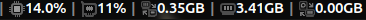
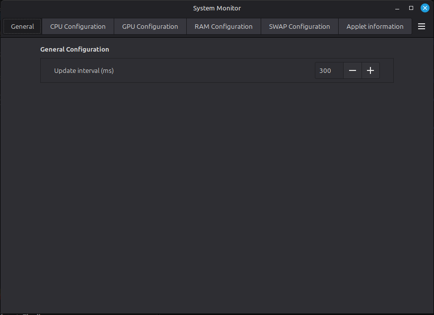
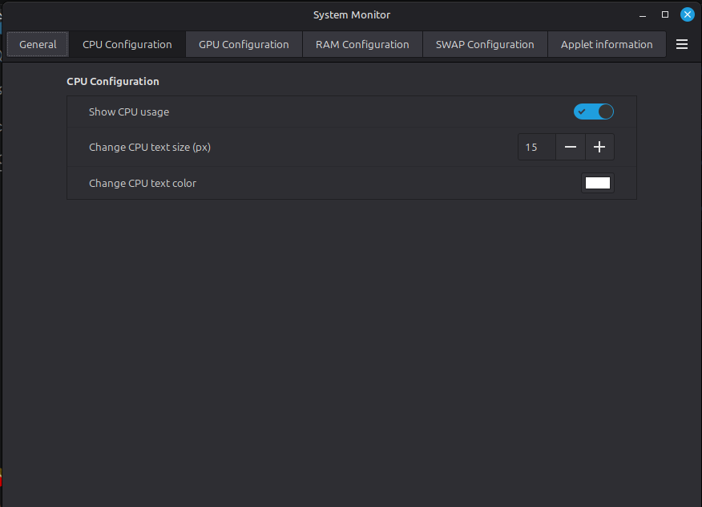
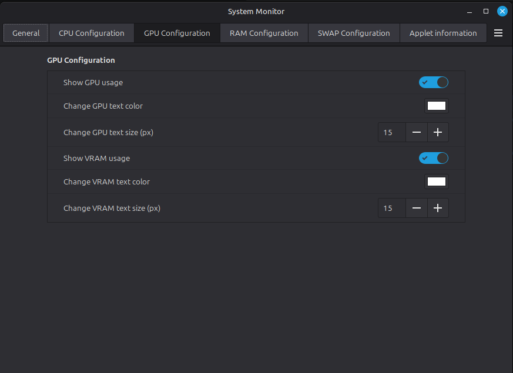
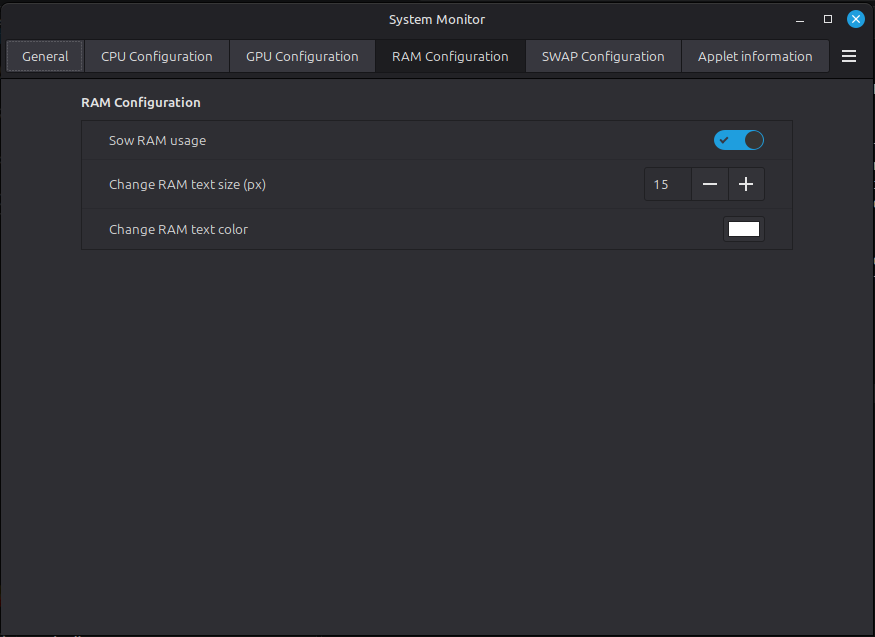
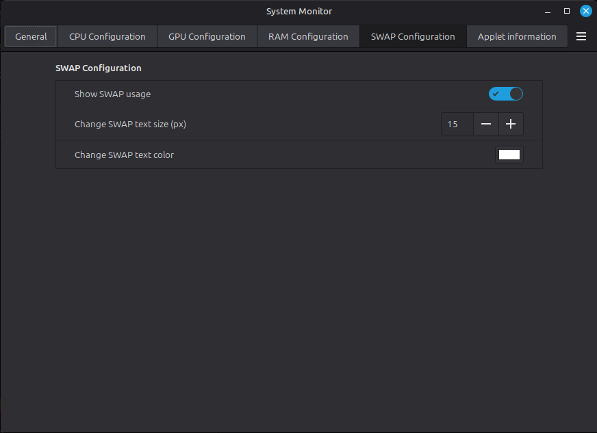
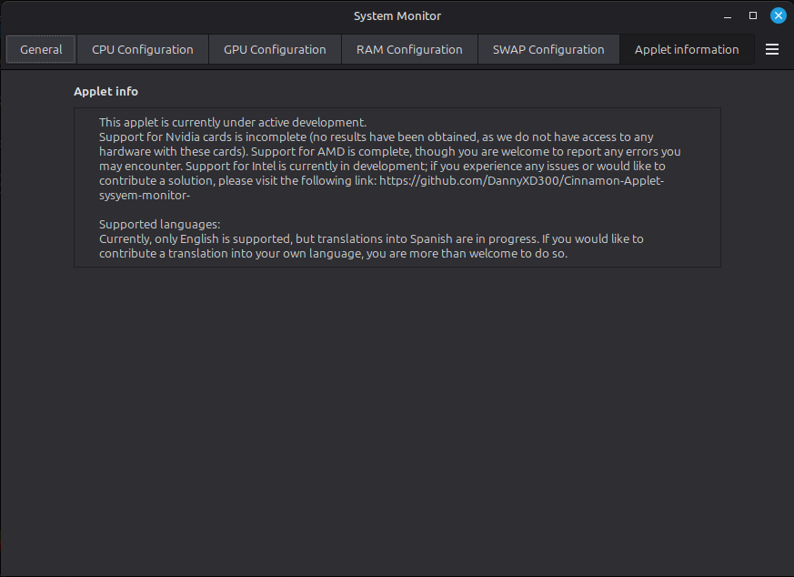

applet-monitor-de-de-sistema
A lightweight, native applet for Cinnamon that displays CPU, GPU, RAM, SWAP, and VRAM usage. (Beta)

It is currently in the testing phase. It works on AMD systems and partially on Intel systems. Compatibility with Intel or Nvidia GPUs is still a work in progress (currently non-functional). If you would like to help improve the applet, please provide your exact GPU model. You are also welcome to run your own tests and submit your findings—along with your GPU model—so that we can work on adding support for your hardware.

If you would like to fix any bugs in the applet's code, you are free to do so; you may also contribute to its development by submitting your changes to the repository.

Applet appearance:

applet configuration.

